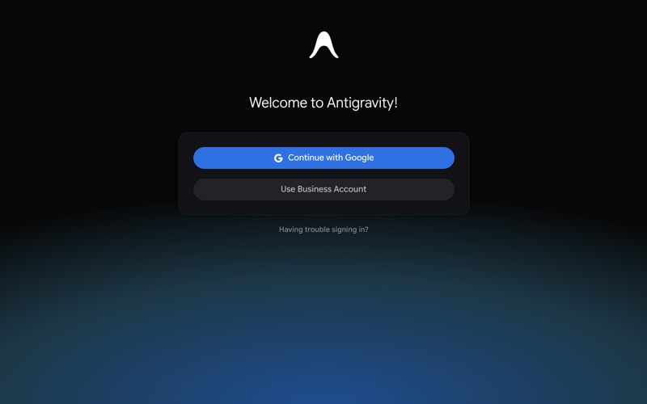

# GeminiCage

在 Mac 或 Windows x64 电脑上开一台独立的虚拟机，里面运行 **Google Antigravity、Gemini 网页版和 Antigravity CLI**。你可以在同一个工作台中选网络出口、打开项目、编辑代码、使用终端，并在虚拟机自己的浏览器里登录 Google。

**[下载 GeminiCage 2.0.4 · Mac 版（Apple 芯片）](https://github.com/lgd8981289/GeminiCage/releases/download/v2.0.4/GeminiCage-2.0.4-macos-arm64.dmg)**　·　[发行说明与 SHA-256 校验文件](https://github.com/lgd8981289/GeminiCage/releases/tag/v2.0.4)

**[Windows x64 测试版下载与校验](https://github.com/lgd8981289/GeminiCage/releases/tag/v2.0.5-beta.1)**　·　[Windows 中文安装指南](docs/windows.md)

以下流程以 Mac 稳定版为例。

| 开始前 | 你需要准备的东西 |
| --- | --- |
| 电脑 | Apple 芯片的 Mac，macOS 14 或更高。在苹果菜单的「关于本机」可以查看芯片和系统版本。 |
| 网络 | 你自己的可用代理节点、Clash/Mihomo 订阅链接或配置文件。首次安装客机、桌面和 CLI 都需要下载。 |
| 账户 | 工作台的本地密码由你创建。登录 Antigravity 时，在客机浏览器中使用自己的 Google 账号。 |

## 从安装到第一次对话

### 1. 把 Gemini Cage 放进「应用程序」

打开上面的 DMG，把 **Gemini Cage.app** 拖到旁边的 **Applications**，再从「应用程序」打开。使用发行包可以直接安装，基础客机组件和代理核心已经随包提供。

当前版本采用本地签名。若 macOS 提示无法验证开发者，可从发行页下载 `SHA256SUMS`，在「下载」目录运行下面的命令，将输出与文件中对应 DMG 的一行比较。确认下载来源和校验值后，按 Apple 的「隐私与安全性 → 仍要打开」流程处理。[Apple 打开受信任应用的说明](https://support.apple.com/zh-cn/102445)

```sh
cd ~/Downloads
shasum -a 256 GeminiCage-2.0.4-macos-arm64.dmg
```

**用微信扫一扫，关注公众号「程序员Sunday」**。我在公众号分享 AI 工具和编程实操。第一次安装客机需要一点时间，可以先把公众号和这份指南收藏起来，之后配置代理和项目时方便再找。手机上也可以打开微信「搜一搜」，输入 **程序员Sunday**。

<a href="docs/images/wechat-sunday.jpg"></a>

### 2. 创建本地工作台账户，保存恢复密钥

首次打开时，在「注册 Gemini Cage 账户」设置用户名和密码。下一页会显示恢复密钥，将它保存到自己的密码管理器，再继续。这个账户用于解锁本机工作台；Google 授权在第 5 步完成。

### 3. 配置客机的网络出口

1. 在首次引导的代理页面，或「设置 → 网络与代理」，点 **添加来源**。
2. 有订阅地址就选「订阅链接」；有现成文件就选「本地 YAML」；只有单个节点的参数就选「手动节点」。填写后点 **导入并验证**。
3. 在「可用节点」中选好最终出口，点 **应用代理**，看到「当前配置已应用」再继续。使用多跳代理时，先在链路预览中确认各跳顺序和最终出口。
4. 如果你同时使用 Claude Cage，希望两个工作台走同一出口，请在 Gemini Cage 中导入相同来源，选择相同节点和顺序。两套工作台分别保存配置，之后换节点也要分别操作。

### 4. 创建 Debian 客机，通过网络检查

在工作台选择 **Debian 13** 并启动环境。本版在 Apple 芯片 Mac 上实测了这条路径。首次启动会下载系统镜像和工具，进度可以在「操作详情」中查看。安装完成后按引导运行网络检查，待工作台显示环境已连接、网络检查通过，再使用浏览器或终端。

如果代理已应用但网络仍暂停，到「网络与代理」核对节点，打开检查结果查看失败项。更换出口后重新运行检查。

### 5. 打开 Antigravity，登录 Google

在左侧点击 **Antigravity → 下载并安装**。安装器从 Google 获取发行包并校验 SHA-256。出现欢迎页后点 **Continue with Google**，在**虚拟机里的浏览器**完成登录；若浏览器询问是否打开 Antigravity，允许后即可回到应用。登录完成后可以从一个简单问题开始，例如「介绍一下当前项目的目录结构」。

使用 Gemini 网页版时，可从侧栏打开 **Gemini 账号管理 → 选择账号并打开 Gemini**。桌面和 CLI 分别授权。在桌面工具栏点 **检测环境 → 检测 Antigravity**，可查看客机观测到的运行状态和版本。

下图来自 Debian 客机中实际启动的 Antigravity 2.33.0。



### 6. 把自己的项目交给客机

- **使用项目和编辑器**：在侧栏「项目」旁点 **＋**，选择要共享的 Mac 项目文件夹，再从工作台打开编辑器。共享项目中的修改会写回 Mac，请选中具体项目目录。
- **使用命令行**：选中项目，在新建终端菜单选择 **Antigravity 终端**。首次使用会在客机内安装官方 `agy`，随后从所选项目目录启动。登录后，`/usage` 可查看配额，`/resume` 可继续已有会话。[Google CLI 配额说明](https://antigravity.google/docs/cli/commands/usage)
- **只用网页版**：点左侧「浏览器」旁的四角星，即可在客机中打开 Gemini。也可以从浏览器设置更改主页。
- **结束工作**：先保存文件，再在工作台停止环境。下次打开 Gemini Cage 并启动同一客机，即可继续使用原磁盘和项目。

## 常见问题

**安装中断，在哪里看具体原因？**

在「安装与检查」点「查看操作详情」。页面会显示最近执行的步骤，以及已识别故障的中文原因和处理办法。需要排查时可展开「查看原始日志」，或在「日志与诊断」导出记录。Google 登录页和 Antigravity 自身的提示语言由相应服务决定。

**2.0.1 在「安装与检查」提示退出码 1，操作详情里有 `project path contains whitespace`，怎么办？**

安装上方的最新版，退出旧版并重新打开 Gemini Cage，点「继续安装」。新版会沿用已准备的基础镜像和已有虚拟机标识，并使用不含空格的默认传输目录。旧传输目录 `~/Documents/Gemini Cage/Downloads` 中已有的文件仍可在 Finder 中找到。

**已经安装 Claude Cage，会共用账号和磁盘吗？**  
Gemini Cage 的本机配置位于 `~/Library/GeminiCage`，使用独立的账户、钥匙串标识和虚拟机。默认文件传输目录为 `~/Documents/GeminiCage/Downloads`。旧版 Gemini QEMU 启动器的用户，可从「文件 → 打开旧版 Antigravity 环境…」回到原来的客机。

**桌面安装成功，但应用没打开怎么办？**  
先确认工作台显示客机已运行，再在 Antigravity 页点「打开 Antigravity」。Linux 版的「修复安装」会重新下载并验证本版支持的 Google 发行包。Google 授权页打不开时，先在客机浏览器测试登录页是否可达，再查看网络检查结果。

**可以在手机上继续会话吗？**  
可在 Antigravity 终端输入 `/remote-control`，在手机浏览器用同一 Google 账号打开终端显示的会话链接。需要关闭时输入 `/remote-control off`。[Google 远程会话说明](https://antigravity.google/docs/remote-control/)

**哪些功能经过验证？**  
已在独立的 Debian 13 客机中验证安装、网络检查、Antigravity 欢迎页到 Google 授权页，以及 CLI 在所选项目中启动。macOS 客机的 Google 安装介质已校验签名和版本，完整首次安装流程尚待实机验证。实体手机配对、外部 SSH 和 Tailscale 跨设备连接尚待端到端验证。Windows 工作台通过客机浏览器打开 Gemini；Google 多账号额度自动调度尚未实现。

## 命令行与自动化

安装到「应用程序」后，可用以下只读命令查看中文帮助、接口列表和当前环境状态。

```sh
cage="/Applications/Gemini Cage.app/Contents/Resources/cage"
"$cage" help
"$cage" agent capabilities
"$cage" agent call status
```

`agent` 返回 JSON，供脚本判断结果。首次查询状态前，请先打开并解锁工作台。

## 从源码构建

开发环境需要 Apple 芯片 Mac、Xcode Command Line Tools（含 Swift 编译器）、Git、Go 1.26.10 或更高、Node.js 22.20 或更高和 npm。构建脚本从上游 **Cage 0.1.8 macOS arm64** 软件包只读提取基础组件；可直接挂载上游磁盘映像。下面的命令适用于本次发布的版本。[上游 0.1.8 发行页](https://github.com/Lee-xeo/Claude-Cage/releases/tag/v0.1.8)

```sh
git clone --branch v2.0.4 https://github.com/lgd8981289/GeminiCage.git
cd GeminiCage

# 单独运行这个子 shell。退出时会卸载构建用的上游映像。
(
  set -eu
  kit_dir=$(mktemp -d)
  mkdir "$kit_dir/mount"
  curl -fL --retry 3 \
    https://github.com/Lee-xeo/Claude-Cage/releases/download/v0.1.8/Cage-0.1.8-macos-arm64.dmg \
    -o "$kit_dir/Cage.dmg"
  (cd "$kit_dir" && echo 'a6e8c6d241a4831e118e692f66586fdad322c1578f9bf16b3da9b212a7d35847  Cage.dmg' | shasum -a 256 -c -)
  hdiutil attach -readonly -nobrowse -mountpoint "$kit_dir/mount" "$kit_dir/Cage.dmg"
  trap 'hdiutil detach "$kit_dir/mount"' EXIT
  GEMINI_CAGE_BASE_APP="$kit_dir/mount/Cage.app" bash scripts/build-app.sh
)
open "_output/Gemini Cage.app"
```

如果本机已经安装上游 0.1.8，也可直接在仓库根目录运行 `bash scripts/build-app.sh`。产物为 `_output/Gemini Cage.app`。

## 上游与许可

GeminiCage 基于 Lee-xeo 的 **Claude Cage 0.1.8**，后者基于 Sylvain Zimmer 的 **agent-vm**。项目延续 MIT 许可，保留原作者版权及第三方许可声明。Mihomo、noVNC、SSHFS 等组件遵循各自许可；发行页附有 Mihomo 和 macOS 客机组件的对应源码。[上游源码快照](https://github.com/Lee-xeo/Claude-Cage/tree/ee25ae650e2b3d89b8e157cbe58aadb610479d0d) · [LICENSE](LICENSE) · [NOTICE](NOTICE) · [第三方许可](THIRD_PARTY_LICENSES)
